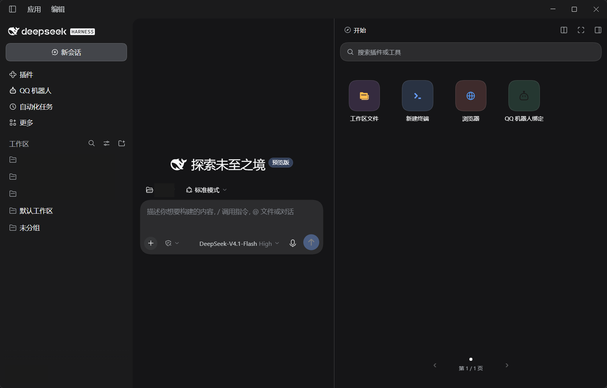

# DSH AppView（DSH 应用桌面）

插件包名：`dsh-appview`，公开版本 `0.3.1`。

在 DSH 右侧引导页，用应用图标展示已注册的工具入口。支持搜索、点击打开、动态入口、鼠标拖拽和触屏长按排序、响应式分页、滑动/按钮翻页及边缘停留跨页拖拽。



- 普通点击、轻触、Enter 或 Space 打开工具；拖拽松手重排，不打开工具。
- 关闭右侧主面板最后一个工具标签后，显示应用桌面并保持当前窗口大小、位置和全屏/普通模式。其他标签、浮动窗口及主动收起沿用 DSH；工具清理失败时保留工具。
- 搜索匹配标题、描述、kind、provider 和入口 id，多词全部匹配；Esc 或 × 清空。搜索结果只查找、打开和分页，不排序。
- 排列顺序保存在宿主机，由同一 DSH 实例的对话和客户端共享。面板尺寸只决定本地行列和分页，不改变顺序。
- 新入口追加到完整顺序末尾，移除后其他入口补位；保存失败或版本冲突有提示与回退。
- 默认 JSON 存储域为 `dsh_appview_layout`，文件位于宿主配置的存储根目录，默认 `$DSH_HOME/storages/dsh_appview_layout.json`。

启用后接管所有对话的引导页正文。返回桌面仅限最后一个工具关闭；多工具快捷切换、状态保留、最近任务、分组和小组件不在当前交付范围。本插件不依赖本项目的系统服务、应用入口子插件或专属 agent。


基于 DSH `0.2.1-rc.5`：宿主需 `connection` 和 `storageDomain`，浏览器需 `slots`、`sidebarRightTabs`、`sidebarRight`、`connection`、`modules`。包内声明客户端加载顺序；React 由 DSH 提供，没有运行时 npm 依赖。宿主 bundle 包含 Zod Mini，许可见 `THIRD_PARTY_NOTICES.md`。

## 安装 / Installation

已验证环境：DeepSeek Harness **0.2.1-rc.5** 的 web profile。其他版本和真实触屏设备仍待验证。

```sh
dsh plugin --profile web add https://github.com/iceshard999/dsh-appview/releases/download/v0.3.1/dsh-appview-0.3.1.tgz
```

重新启动对应的 DSH web 实例并刷新页面，在任一对话中打开右侧栏即可使用。卸载：`dsh plugin --profile web remove dsh-appview`。

DSH AppView turns the right-sidebar guide into a searchable, paged launcher for registered tools. Drag icons to reorder them; the layout is saved on the DSH host. Closing the last tool returns to the launcher without resizing the panel. The command above installs the prebuilt bundle for the web profile.

## 开发与验证 / Development

```sh
npm install
npm run build
DSH_PACKAGES=/path/to/node_modules/@deepseek-ai npm run pack
```

`DSH_PACKAGES` 指向 DSH 0.2.1-rc.5 安装中的 `@deepseek-ai` 包目录，供宿主集成检查使用。`npm run pack` 会重建两个 bundle、执行回归检查并生成 `dist/dsh-appview-0.3.1.tgz`。修改 `src/` 后重新构建，勿直接编辑 `lib/`。

使用 Bash 运行 `DSH_CLI=/path/to/dsh npm run verify:install`，它会安装到项目内的隔离 profile。浏览器和真实界面脚本见 `npm run verify:browser` 和 `npm run verify:gui`（需 Playwright Chromium；可设置 `PLAYWRIGHT_PATH` 与 `PLAYWRIGHT_BROWSERS_PATH`，GUI 检查还需先完成隔离安装）。

项目使用 [MIT 许可证](LICENSE)；Zod Mini 的许可见 [第三方声明](THIRD_PARTY_NOTICES.md)。
